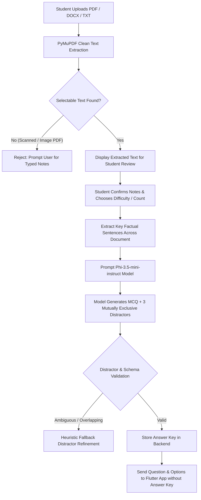
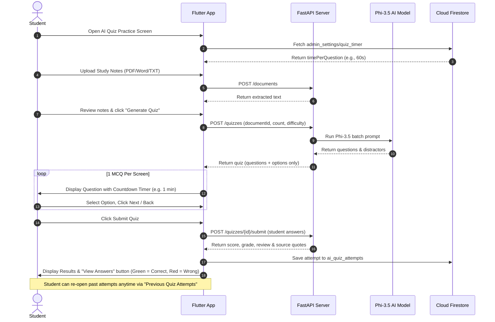

# AI Quiz Module — Architecture, AI Engine Flow & Local Setup Guide

Welcome to the comprehensive technical documentation for the **GovtQuest AI Quiz Module**. This document provides an in-depth breakdown of how the AI generation engine works, the complete end-to-end data flow, and instructions for running the entire system locally.

---

## 1. System Overview & Technology Stack

The AI Quiz system enables students to generate high-yield, source-grounded practice quizzes directly from their own study notes (PDF, Word, or TXT). 

```
┌────────────────────────────────────────────────────────────────────────┐
│                          FLUTTER MOBILE APP                            │
│  • 1 MCQ Per Screen Player         • Next / Back Navigation            │
│  • Per-Question Countdown Timer    • Result Screen + View Answers      │
│  • Dynamic Hamburger Menu User     • Previous Quiz Attempts History    │
└───────────────────▲────────────────────────────────▲───────────────────┘
                    │ REST API                       │ Firestore / Auth
                    ▼                                ▼
┌──────────────────────────────────────┐   ┌─────────────────────────────┐
│       FASTAPI BACKEND SERVER         │   │      FIREBASE PLATFORM      │
│ • PyMuPDF Clean Document Parser      │   │ • Firebase Authentication   │
│ • Candidate Extraction & Sampling    │   │ • Firestore:                │
│ • Distractor Quality Validator       │   │    - ai_quiz_attempts       │
│ • Deterministic Evaluator & Grader   │   │    - admin_settings/quiz_timer
└───────────────────▲──────────────────┘   │    - users                  │
                    │                      └─────────────────────────────┘
                    ▼
┌────────────────────────────────────────────────────────────────────────┐
│                   AI MODEL: Phi-3.5-mini-instruct                      │
│ • 3.82 Billion Parameters · 128K Context Window                        │
│ • Zero-Hallucination Factual Grounding from Uploaded Source Text       │
│ • Strict Structured JSON Schema Output (Easy, Medium, Hard)            │
└────────────────────────────────────────────────────────────────────────┘
```

### Core Components

1. **Frontend (Flutter)**:
   - Located in [`flutter project/lib/pages/Quiz/ai_quiz_screen.dart`](file:///d:/quiz%20ai%20module/flutter%20project/lib/pages/Quiz/ai_quiz_screen.dart).
   - Implements **1 MCQ per screen** with **Next/Back buttons**, a **countdown timer** (default 1 min, set by Admin), an **answer review screen** highlighting correct answers in **Green** and wrong answers in **Red**, and **Firestore-persisted historical attempt reviews**.
   - Dynamic drawer navigation displaying the logged-in user profile.
2. **Backend (Python FastAPI)**:
   - Located in [`ai_quiz_agent/`](file:///d:/quiz%20ai%20module/ai_quiz_agent).
   - Handles clean text extraction from uploaded study materials, orchestrates prompts, validates question distractors, and executes deterministic grading.
3. **AI Generation Engine (`microsoft/Phi-3.5-mini-instruct`)**:
   - Advanced 3.82-billion parameter model optimized for reasoning, distractor generation, and structured JSON output.
   - Supports local CPU execution, local GPU, or cloud GPU (Google Colab).
4. **Database & Auth (Cloud Firestore & Firebase Auth)**:
   - Stores quiz attempts, user results, and global admin settings (`admin_settings/quiz_timer`).

---

## 2. How the AI Engine Works

The generation pipeline guarantees that every question and correct answer is **100% grounded** in the student's study material, completely avoiding AI hallucinations.



### Step 1: Clean Document Ingestion & Scanned PDF Rejection
- Accepts `.pdf`, `.docx`, and `.txt` up to 25 MB.
- **Scanned / Handwritten Rejection**: The backend parses each page using `fitz` (PyMuPDF). If a page has no selectable text (i.e. it is an image scan or handwritten photograph), the system rejects the file with a clear error:
  > *"Page X has no usable selectable text. Scanned and handwritten PDFs are not supported. Choose text-based pages or upload typed Word/TXT notes."*

### Step 2: Student Note Review & Confirmation
- Before generating questions, the app presents the extracted text in an editable preview window.
- The student can fix OCR typos, delete irrelevant sections, and explicitly check: *"I checked this text against my notes"*.

### Step 3: Factual Sentence Sampling
- Python algorithms parse the reviewed text into candidate sentences spread evenly across the document.
- Only sentences containing strong factual predicates (nouns, numbers, definitions, scientific terms) are selected.

### Step 4: Multi-Difficulty MCQ Generation
The student selects difficulty level:
- **Easy**: Direct factual recall; correct answer appears verbatim in the supporting source quote.
- **Medium**: Conceptual comprehension and relationship understanding.
- **Hard**: Multi-step reasoning and analytical comprehension based on the passage context.

### Step 5: Distractor (Wrong Option) Generation & Quality Validation
Unlike naive generators that produce random words or confusing near-synonyms, the pipeline enforces strict distractor rules:
1. **Plausibility**: Distractors must be of the same grammatical category (e.g. if the answer is a planet, all distractors are astronomical bodies).
2. **Mutual Exclusivity**: No two options can be synonyms (e.g. "Steam" vs "Water Vapour" is disallowed).
3. **Factually Untrue for the Prompt**: Distractors cannot be alternative valid answers to the same question.

### Step 6: Deterministic Server-Side Grading
- Correct answers are withheld from the mobile client during the quiz attempt.
- Upon submission, the backend evaluates the student's choices against the stored key.
- Generates score, letter grade (A+, A, B, C, D, F), topic-level breakdown, and educational recommendations linked to source quotes.

---

## 3. End-to-End Quiz Attempt Flow



---

## 4. How to Run Locally

You can run the entire system on your development machine using Windows PowerShell.

### Prerequisites
- **Python 3.10+** (installed and added to PATH)
- **Flutter 3.x+** (with Android Studio / Chrome for web testing)
- Physical Android phone or Android Emulator

---

### Step 1: Set Up Python Backend Environment

1. Open PowerShell in the project root:
   ```powershell
   cd "D:\quiz ai module"
   ```
2. Create and activate a virtual environment (if not already done):
   ```powershell
   python -m venv .venv
   .\.venv\Scripts\Activate.ps1
   ```
3. Install required Python packages:
   ```powershell
   pip install -r ai_quiz_agent\requirements.txt
   ```

---

### Step 2: Start the FastAPI Server

Run the backend server on port `8000`:
```powershell
python -m ai_quiz_agent.api
```
Or use the automated PowerShell startup script:
```powershell
powershell -ExecutionPolicy Bypass -File .\scripts\start_local.ps1
```

You will see:
```text
INFO:     Uvicorn running on http://0.0.0.0:8000 (Press CTRL+C to quit)
INFO:     Application startup complete.
```
*You can open `http://127.0.0.1:8000/docs` in your browser to view the interactive Swagger API documentation.*

---

### Step 3: Run the Flutter Mobile App

In a second PowerShell terminal:

#### Option A: Run in Chrome / Web
```powershell
cd "D:\quiz ai module\flutter project"
flutter run -d chrome
```

#### Option B: Run on Android Emulator or Physical Phone
Connect your phone with a USB cable (with USB debugging enabled) or start the Android emulator:
```powershell
cd "D:\quiz ai module\flutter project"
flutter devices
flutter run -d <DEVICE_ID>
```

---

### Step 4: Connect the Flutter App to the Backend

The Flutter app includes an **in-app connection configuration modal**, so you do not need to hardcode IP addresses or rebuild the APK:

1. On the **AI Quiz** screen in the app, tap the **Settings (gear icon ⚙️)** in the top AppBar.
2. Enter your backend URL:
   - **For Chrome / Web**: `http://127.0.0.1:8000`
   - **For Android Emulator**: `http://10.0.2.2:8000`
   - **For Physical Phone on Home WiFi**: Enter your PC's local WiFi IP (e.g. `http://192.168.100.246:8000`)
3. Token: `dev-insecure-token`
4. Tap **Save & Connect**. The app connects immediately!

---

### Step 5: Admin Side Timer Configuration

The MCQ time limit defaults to **60 seconds (1 minute)** per question, and can be configured from the **Admin Dashboard**:
1. Log in with an admin account (e.g. `admin07@gmail.com`).
2. Open the navigation drawer and tap **"Quiz Timer Settings"**.
3. Choose a preset (`30s`, `60s / 1 min`, `90s`, `120s`) or type a custom duration in seconds.
4. Click **Save Timer**.
5. The setting is saved to Firestore under `admin_settings/quiz_timer` and instantly applies to all student devices attempting AI quizzes.

---

## 5. Alternative: Running Backend with Free Google Colab GPU

If your local computer does not have a dedicated GPU and you want fast AI generation (~3–8 seconds per quiz), use Google Colab's free T4 GPU.

### Why Phi-3.5-mini Replaced Qwen2.5-3B

1. **High Quality Distractors**: Phi-3.5 generates mutually exclusive, plausible distractors without confusing synonyms or overlapping categories.
2. **Reliable JSON Formatting**: Native support for strict structured JSON output eliminates decoding retries.
3. **Speed on Colab T4 GPU**: ~3–8 seconds per quiz generation (compared to 30–60+ seconds on CPU).
4. **Context Window**: Supports large study passages (up to 32K–128K tokens).

### Model Format

- **Colab GPU (primary)**: SafeTensors — loaded via Hugging Face `transformers` (`AutoModelForCausalLM.from_pretrained`).
- **Local CPU (legacy fallback)**: GGUF (`Q4_K_M` quantized) — served by `llama-server.exe` (llama.cpp).

### Step 1: Upload Files to Google Colab

1. Open [Google Colab](https://colab.research.google.com/).
2. Click **Upload** and upload `Quiz_AI_Phi35.ipynb`.
3. In the Colab menu, select: **Runtime** → **Change runtime type** → Hardware accelerator: **T4 GPU** → Click **Save**.
4. Click the folder icon (**Files** panel) on the left sidebar in Colab and upload `quiz-project-current.zip`.

### Step 2: Run Notebook Cells

Run the cells in order:
- **Cell 1**: Hardware check (confirms T4 GPU is active).
- **Cell 2**: Installs dependencies and unzips `quiz-project-current.zip` into `/content/quiz_ai_module`.
- **Cell 3**: Loads `microsoft/Phi-3.5-mini-instruct` in float16 onto the GPU.
- **Cell 4 & 5**: Benchmarks speed and runs distractor quality tests.
- **Cell 6**: Tests the full quiz generation pipeline.
- **Cell 7**: Runs backend unit tests (`18 passed`).
- **Cell 8**: (Optional) LoRA fine-tuning with diverse multi-subject training data.
- **Cell 9**: Interactive Jupyter widget UI for in-notebook testing.
- **Cell 10**: **Start FastAPI Server + ngrok tunnel for Flutter app**.

### Step 3: Exposing the API for your Phone (Cell 10)

Cell 10 is configured to accept your ngrok static domain and authtoken:
```python
# Paste your ngrok credentials here (do not commit secrets to git)
NGROK_TOKEN = "your_ngrok_token_here"
NGROK_DOMAIN = "your-subdomain.ngrok-free.app"  # or leave empty for random URL

tunnel = ngrok.connect(8000, domain=NGROK_DOMAIN) if NGROK_DOMAIN else ngrok.connect(8000)
```
When you run Cell 10, the output will display your active URL:
```
============================================================
PUBLIC URL: https://your-subdomain.ngrok-free.app
API TOKEN:  dev-insecure-token
============================================================
```
> [!NOTE]
> If using a reserved static domain from your ngrok dashboard, your URL remains permanent across Colab restarts!

### Step 4: Connecting the Flutter App on Your Phone

**Method A: Automatic / In-App Settings**
1. Open the Flutter app on your phone.
2. Go to **AI Quiz**.
3. Tap the **Settings (Gear icon ⚙️)** in the top right AppBar.
4. Set Server URL to your public ngrok URL (e.g. `https://your-subdomain.ngrok-free.app`).
5. Token: `dev-insecure-token`
6. Tap **Save & Connect**.

**Method B: Build with Compile-time Flags (Optional)**
```bash
flutter run --dart-define=QUIZ_API_URL="https://your-subdomain.ngrok-free.app" --dart-define=QUIZ_API_TOKEN="dev-insecure-token"
```

---

## 6. Directory Structure Reference

```text
D:\quiz ai module\
├── docs/
│   └── AI_QUIZ_SYSTEM_GUIDE.md  # Master architecture & setup guide (this document)
├── README.md                    # Quickstart documentation & project status
├── AGENTS.md                    # Agent rules (do not push to main)
├── Quiz_AI_Phi35.ipynb          # Jupyter notebook for Colab GPU execution
├── quiz-project-current.zip     # Backend source package for Colab
│
├── ai_quiz_agent/               # Python FastAPI backend
│   ├── api/app.py               # REST API endpoints & route handlers
│   ├── agents/                  # Quiz generation agent & prompt templates
│   ├── services/                # PyMuPDF document extraction & grading service
│   ├── providers.py             # Phi-3.5 model loader & JSON generator
│   ├── workflow.py              # End-to-end quiz workflow orchestrator
│   └── requirements.txt         # Python dependencies
│
├── flutter project/             # GovtQuest Flutter application
│   └── lib/
│       ├── pages/Quiz/
│       │   ├── ai_quiz_screen.dart   # 1 MCQ/screen, timer, answers & history
│       │   └── quizselection.dart    # Quiz mode selection & history card
│       ├── AdminModules/
│       │   └── adminDashboard.dart   # Admin dashboard & Quiz Timer settings
│       └── Services/quiz_api.dart    # HTTP API client
│
├── scripts/                     # PowerShell startup scripts
├── examples/                    # Sample study notes for testing
├── backups/                     # Historical archives & OCR reference
└── training/                    # Optional LoRA training pipeline
```
